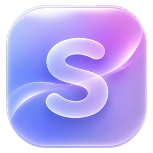

<p align="center"></p>

# Satin Glass

[English](README.md) · **한국어** · [문서](https://webispy.github.io/satin-glass/)

[](https://www.npmjs.com/package/@satin-glass/react)
[](https://github.com/webispy/satin-glass/actions/workflows/ci.yml)
[](https://webispy.github.io/satin-glass/)
[](LICENSE)

빛을 따르는 유리 재질 위에 만든 React UI 라이브러리. 결이 있는 반투명 유리, 위에서 오는 고정된 빛, 포인터 아래 은은한 광택, 늘어났다 달라붙는 모션이 특징이다. 디자인 토큰, 프레임워크 없는 동작 코어, React 컴포넌트, 문서·카탈로그 앱으로 이루어진 pnpm 모노레포다.

> 상태: **0.6.0**. 변경 내역은 [`CHANGELOG.md`](CHANGELOG.md)에 있다.

## 구성

| 경로 | 패키지 | 내용 |
|---|---|---|
| `packages/tokens` | `@satin-glass/tokens` | OKLCH 팔레트, 테마 4종(라이트·다크·고대비 2종), 간격·반경·글자·모션 토큰 → `tokens.css`와 TS 값. 빌드할 때 WCAG 대비를 검사한다 |
| `packages/core` | `@satin-glass/core` | 프레임워크 없는 동작(스프링, 포인터 광택, 물방울 선택 표시, 오버레이 배치·피어남·포커스·레이어 스택, 드래그·길게 누르기)과 컴포넌트 CSS(`styles.css`, 카테고리별 `css/*.css`, `styles.layer.css`) |
| `packages/react` | `@satin-glass/react` | React 컴포넌트와 훅. 카테고리별 진입점(`/controls`, `/data` …)과 코어의 CSS를 함께 싣는다 |
| `packages/a2ui` | `@satin-glass/a2ui` (비공개, 배포하지 않음) | A2UI 에이전트 화면(프로토콜 v1.0·v0.9.1, 기본 카탈로그)을 Satin Glass 컴포넌트로 그린다. 문서의 A2UI 페이지가 이 패키지를 쓴다 |
| `apps/docs` | — | 문서·카탈로그 앱(Vite). 테마 전환과 실제 앱 형태의 쇼케이스 포함 |
| `tests/e2e` | — | Playwright: 상호작용(Chromium·WebKit·Firefox), 성능(CPU 4배 감속), 스크린샷 |

## 사용

React 앱은 `@satin-glass/react` 하나만 설치하면 된다. 토큰과 코어는 의존성으로 함께 설치된다.

```bash
npm i @satin-glass/react
```

```tsx
import '@satin-glass/react/styles.css';                 // 전체 스타일 한 파일
import { ThemeProvider, createTheme, Button } from '@satin-glass/react';

<ThemeProvider theme={createTheme({ mode: 'system', locale: 'ko-KR' })}>
  <Button variant="filled">계속</Button>
</ThemeProvider>
```

테마에서 언어를 정하지 않으면 `en-US`다. 한국어 앱은 `createTheme({ locale: 'ko-KR' })`로 한 번 정하면 날짜·시간·숫자·표 정렬과 컴포넌트에 내장된 문구가 모두 그 언어를 따른다. 형식은 모든 로케일을 지원하고, 내장 문구는 영어와 한국어가 있다(다른 언어는 영어).

### 카테고리별로 나눠 쓰기

컴포넌트와 스타일은 같은 이름의 카테고리로 나뉜다. 루트(`@satin-glass/react`)에서 모두 가져와도 되고, 카테고리 경로에서 가져와도 된다. JS는 번들러가 쓰지 않는 코드를 걷어 내므로 어느 쪽이든 결과 크기는 같다. 카테고리 경로는 스타일을 필요한 것만 불러올 때 짝을 맞추기 쉽게 하려고 둔다.

```tsx
import '@satin-glass/react/css/foundation.css';         // 항상 맨 먼저 (토큰 포함)
import '@satin-glass/react/css/controls.css';
import '@satin-glass/react/css/data.css';
import '@satin-glass/react/css/selection.css';          // data에 필요
import '@satin-glass/react/css/overlays.css';           // data와 selection에 필요
import '@satin-glass/react/css/layout.css';             // data에 필요

import { ThemeProvider } from '@satin-glass/react/foundation';
import { Button } from '@satin-glass/react/controls';
import { DataTable, LineChart } from '@satin-glass/react/data';
```

| 카테고리 | 컴포넌트 | 함께 불러올 CSS (foundation 외) |
|---|---|---|
| `foundation` | `ThemeProvider` `createTheme` `useTheme` `useLocale` `useMotion` `MotionScope` `Glass` `Text` `Stack` `Divider` `Portal` `VisuallyHidden`, 아이콘, `useControllable` `useImageTint` `useGlassLight` | — |
| `controls` | `Button` `IconButton` `ButtonGroup` `Switch` `Slider` `Stepper` `SegmentedControl` `TextField` `SearchField` `FilterBar` `Chip` `Badge` `BadgeAnchor` `Avatar` `AvatarGroup` `Progress` `Spinner` `PageControl` | — |
| `layout` | `Card` `CardMedia` `CardBody` `CardHeader` `List` `ListItem` `ListSection` `Accordion` `Skeleton` `MediaViewer` `Timeline` `TimelineItem` | — |
| `navigation` | `TabBar` `Tab` `TabBarAction` `Tabs` `AppBar` `ScrollFade` `Sidebar` `SidebarSection` `SidebarItem` `Breadcrumbs` `NavigationStack` `NavigationPage` `useNavigation` `Pagination` `pageWindow` | — |
| `selection` | `Checkbox` `RadioGroup` `Radio` `ChoiceList` `Select` `Combobox` `Calendar` `DatePicker` `RangeCalendar` `DateRangePicker` `Wheel` `WheelGroup` `TimePicker` `TimeWheel` `WeekdayPicker` `describeWeekdays` `toISODate` `toTimeString` | `controls` `overlays` |
| `overlays` | `Dialog` `Sheet` `Drawer` `Menu` `MenuItem` `MenuSeparator` `MenuLabel` `Popover` `ActionSheet` `ContextMenu` `Toaster` `useToast` `Tooltip` | — |
| `feedback` | `Banner` `EmptyState` `Tag` | — |
| `data` | `DataTable` `ColumnChooser` `LineChart` `BarChart` `DonutChart` `ScatterChart` `Sparkline` `BarMeter` `IntervalPlot` `Stat` `Meter` `meterTone` `niceTicks` | `controls` `selection` `overlays` `layout` |

- 카테고리 CSS는 `foundation.css`만 맨 먼저 오면 나머지 순서는 상관없다. e2e(`css-split`)가 모든 문서 페이지에서 순서를 뒤집어 불러와도, 카테고리마다 위 표의 CSS만 불러와도 계산된 스타일이 전체 파일과 같은지 확인한다.
- **CSS 레이어**: 앱에서 CSS 레이어 순서를 직접 정하는 경우(유틸리티 CSS 프레임워크 등)에는 `@satin-glass/react/styles.layer.css`를 쓴다. 전체가 `@layer satin-glass` 안에 들어 있어, 레이어 밖 앱 스타일이 명시도와 상관없이 우선한다. 카테고리 파일은 `@import '@satin-glass/react/css/controls.css' layer(satin-glass);`처럼 직접 레이어에 넣는다.
- **React 없이**: `@satin-glass/tokens/tokens.css`(CSS 변수)와 `@satin-glass/core`(스프링, 포인터 광택, 물방울 선택 표시, 오버레이 배치)를 쓴다. 같은 CSS는 `@satin-glass/core/styles.css`와 `@satin-glass/core/css/*`에도 있다.
- 세 패키지는 버전을 같이 올린다.

글꼴은 Pretendard를 권장한다(라이브러리에 넣지 않음). 문서 앱의 `index.html`처럼 CDN이나 자체 호스팅으로 불러온다.

## 호환성

- **React** 18.2 이상과 React DOM(peer dependency). 문서 앱과 테스트는 React 19에서 실행한다.
- **브라우저**: 최신 Chrome, Edge, Safari, Firefox. 스타일에 `linear()` 이징, `color-mix()`, `:has()`, 컨테이너 쿼리를 쓰므로 최소 지원 버전은 대략 Chrome·Edge 113, Safari 17.2, Firefox 121이다. `backdrop-filter`를 지원하지 않는 브라우저에서는 유리 대신 불투명한 배경을 쓴다.
- **서버 렌더링**: 테스트로 확인한다. 엔트리 포인트(`@satin-glass/react/foundation`, `/controls` …)마다 대표 컴포넌트로 만든 페이지를 `renderToString`으로 렌더링하면 매번 같은 HTML이 나오고, jsdom에서 불일치 없이 하이드레이션된다. 따로 렌더링하는 루트가 여럿이면(한 페이지의 여러 아일랜드 등) 루트마다 다른 `identifierPrefix`를 정해 `renderToString`과 `hydrateRoot`에 똑같이 넘긴다. 생성되는 id는 React의 `useId`로 만들기 때문에, `identifierPrefix`가 같은 두 루트는 id가 겹친다. 시스템 설정을 따르는 옵션(`mode: 'system'` 등)은 서버 기본값(라이트 테마, 기본 대비)으로 먼저 그려지고, 하이드레이션이 끝나면 브라우저 설정으로 바뀐다. 이 전환을 피하려면 쿠키 등에서 읽은 사용자의 선택을 직접 넘긴다. 동작 줄이기와 투명도 줄이기는 예외로, CSS가 처음부터 브라우저 설정을 따른다(투명도 줄이기는 브라우저가 지원할 때만: Chrome·Edge 118 이상. Safari는 아직 지원하지 않고, Firefox는 별도 설정을 켜야 지원한다). 날짜 컴포넌트에 넘기는 날짜는 서버와 브라우저에서 각각 로컬 날짜로 만든다. 예를 들어 `yyyy-mm-dd` 문자열을 나눠 `new Date(2026, 11, 1, 12)`처럼 만들고, JavaScript가 UTC 자정으로 읽는 `new Date('2026-12-01')`은 쓰지 않는다. 특정 시각은 시간대에 따라 날짜가 달라져서, 서버와 브라우저가 서로 다른 날을 보여 주게 된다.
- **크기**(0.6.0, esbuild로 번들·minify한 뒤 gzip, React 제외): `ThemeProvider`와 `Button` 18.5 kB, `DataTable`만 27 kB(앞의 둘에 더하면 8 kB 추가), 전체 82 kB. `styles.css`는 gzip 43 kB이고, 카테고리 파일은 `foundation.css`(13 kB)에 더해 파일마다 1–7 kB다.
- **버전**: 1.0 전에는 마이너 릴리스(0.x)에서 API가 바뀌거나 빠질 수 있다. 바뀐 것은 [`CHANGELOG.md`](CHANGELOG.md)의 Changed·Breaking changes에 대신 쓸 것과 함께 적는다. 패치 릴리스는 버그만 고친다.

## 개발

```bash
pnpm install
pnpm build          # tokens → core → react
pnpm dev            # 문서 앱 (http://localhost:5173)
pnpm test           # 단위 테스트 (Vitest)
pnpm e2e            # 빌드 후 전체 검증: 렌더링 매트릭스, 상호작용, 동작 줄이기, 예외 상황, axe (3개 엔진, 매트릭스와 axe는 영어로도) + 성능
pnpm test:changed   # 바뀐 곳에 해당하는 단위 테스트만
pnpm e2e:changed    # 바뀐 곳에 해당하는 e2e 스위트만 (--dry: 고른 것만 보기, --base <ref>: 비교 기준)
pnpm e2e:changed:quick   # 같은 스위트를 Chromium에서만, 설정 조합 없이 (작업 중에; push 전에는 3개 엔진)
```

`e2e:changed`는 바뀐 파일을 카테고리에 대응시키고(컴포넌트는 카테고리 진입점과 import 관계, CSS는 파일 이름, 문서 페이지는 보여 주는 카테고리나 가져다 쓰는 컴포넌트, 문서 스타일시트는 바뀐 줄의 클래스를 쓰는 페이지), 그 카테고리를 다루는 스위트(각 파일의 `// covers:` 줄)를 세 엔진에서 실행한다. 렌더링 매트릭스·예외 상황·axe·동작 줄이기는 Chromium에서 한 번만 돌린다. 토큰, 코어 동작, foundation처럼 모든 카테고리가 의존하는 것이나 카테고리를 알 수 없는 파일이 바뀌면 전체를 실행한다. 기준은 브랜치에서는 main과의 분기점, main에서는 커밋하지 않은 변경이다. 릴리스 전에는 전체 `pnpm e2e`를 돌린다. 실행할 때마다 스위트별 전체 출력을 `tests/e2e/last-run.log`에 남기고, 실패한 스위트는 맨 끝에 모아 보여 준다.

문서 앱은 URL로 표시 설정을 받는다(`?mode=dark&hc=1&rt=1&rm=1&motion=calm`). 예외 상황을 모아 둔 `#/lab` 페이지가 있다.

설계 원칙과 결정 사항은 [`docs/design-language.md`](docs/design-language.md)에 있다.

## 알려진 한계

- `docs/design-language.md`는 한국어로 되어 있고, 맨 앞에 영어 요약이 있다. 문서 앱은 영어와 한국어로 볼 수 있다.
- 자동 테스트는 데스크톱 엔진에서 터치와 키보드 입력을 에뮬레이션한다. 실제 iOS·Android 기기와 스크린 리더(VoiceOver, TalkBack)에서는 아직 테스트하지 않았다.

## 기여

버그는 보안 문제까지 포함해 [GitHub 이슈](https://github.com/webispy/satin-glass/issues)로 제보한다. [`CONTRIBUTING.md`](CONTRIBUTING.md)와 [행동 강령](CODE_OF_CONDUCT.md)을 참고한다.

## 라이선스

[Apache License 2.0](LICENSE). 이 라이선스는 "Satin Glass"라는 이름을 상표로 쓸 권리는 주지 않는다(6조).
