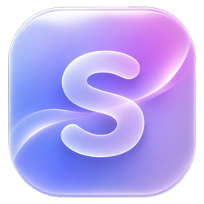

<p align="center"></p>

# Satin Glass

**English** · [한국어](README.ko.md) · [Docs](https://webispy.github.io/satin-glass/)

A React UI library built on a glass material that follows the light: frosted, grained translucency, a fixed top light and a soft sheen under the pointer, with motion that stretches and sticks. It is a pnpm monorepo of design tokens, a framework-free behaviour core, React components, and a docs and catalogue app.

> Status: **0.5.0**. Changes are in [`CHANGELOG.md`](CHANGELOG.md).

## Packages

| Path | Package | What it holds |
|---|---|---|
| `packages/tokens` | `@satin-glass/tokens` | OKLCH palette, four themes (light, dark and two high-contrast), spacing, radius, type and motion tokens, built into `tokens.css` and TS values. The build checks WCAG contrast |
| `packages/core` | `@satin-glass/core` | Framework-free behaviour (springs, the pointer sheen, the stretch-and-stick selection, overlay placement, bloom, focus and layer stacks, drag and long press) and the component CSS (`styles.css`, per-category `css/*.css`, `styles.layer.css`) |
| `packages/react` | `@satin-glass/react` | React components and hooks, with per-category entry points (`/controls`, `/data` …) and the core's CSS |
| `apps/docs` | — | Docs and catalogue app (Vite), with theme switching and an app-shaped showcase |
| `tests/e2e` | — | Playwright: interactions (Chromium, WebKit, Firefox), performance (CPU slowed 4×), screenshots |

## Usage

A React app installs `@satin-glass/react` only; the tokens and the core come with it.

```bash
npm i @satin-glass/react
```

```tsx
import '@satin-glass/react/styles.css';                 // every style in one file
import { ThemeProvider, createTheme, Button } from '@satin-glass/react';

<ThemeProvider theme={createTheme({ mode: 'system' })}>
  <Button variant="filled">Continue</Button>
</ThemeProvider>
```

### By category

Components and styles are split into categories with the same names. Import everything from the root (`@satin-glass/react`) or from a category path. Bundlers drop unused JS either way, so the result is the same size; the category paths make it easy to pair components with the stylesheets they need.

```tsx
import '@satin-glass/react/css/foundation.css';         // always first (includes the tokens)
import '@satin-glass/react/css/controls.css';
import '@satin-glass/react/css/data.css';
import '@satin-glass/react/css/selection.css';          // needed by data

import { ThemeProvider } from '@satin-glass/react/foundation';
import { Button } from '@satin-glass/react/controls';
import { DataTable, LineChart } from '@satin-glass/react/data';
```

| Category | Components | CSS to load as well (besides foundation) |
|---|---|---|
| `foundation` | `ThemeProvider` `createTheme` `useTheme` `MotionScope` `Glass` `Text` `Stack` `Divider` `Portal` `VisuallyHidden`, icons, `useControllable` `useImageTint` `useGlassLight` | — |
| `controls` | `Button` `IconButton` `ButtonGroup` `Switch` `Slider` `Stepper` `SegmentedControl` `TextField` `SearchField` `Chip` `Badge` `BadgeAnchor` `Avatar` `Progress` `Spinner` `PageControl` | — |
| `layout` | `Card` `CardMedia` `CardBody` `CardHeader` `List` `ListItem` `ListSection` `Accordion` `Skeleton` `MediaViewer` | — |
| `navigation` | `TabBar` `Tab` `TabBarAction` `Tabs` `AppBar` `ScrollFade` `Sidebar` `SidebarSection` `SidebarItem` `Breadcrumbs` `NavigationStack` `NavigationPage` `useNavigation` `Pagination` | — |
| `selection` | `Checkbox` `RadioGroup` `Radio` `ChoiceList` `Select` `Calendar` `DatePicker` `RangeCalendar` `DateRangePicker` `Wheel` `WheelGroup` `TimePicker` `TimeWheel` `WeekdayPicker` `describeWeekdays` | `controls` `overlays` |
| `overlays` | `Dialog` `Sheet` `Menu` `MenuItem` `MenuSeparator` `MenuLabel` `Popover` `ActionSheet` `ContextMenu` `Toaster` `useToast` `Tooltip` | — |
| `feedback` | `Banner` `EmptyState` `Tag` | — |
| `data` | `DataTable` `LineChart` `BarChart` `DonutChart` `Sparkline` `BarMeter` `IntervalPlot` `Stat` | `controls` `selection` |

- Only `foundation.css` has to come first; the other category files can load in any order. The `css-split` e2e suite checks, on every docs page, that loading them in reverse, or loading only the files a category needs per the table above, computes the same styles as the single file.
- **CSS layers**: if your app orders its own layers (a utility CSS framework, for example), use `@satin-glass/react/styles.layer.css`. Everything sits in `@layer satin-glass`, so unlayered app styles win regardless of specificity. Put a category file in the layer yourself: `@import '@satin-glass/react/css/controls.css' layer(satin-glass);`.
- **Without React**: use `@satin-glass/tokens/tokens.css` (CSS variables) and `@satin-glass/core` (springs, the pointer sheen, the stretch-and-stick selection, overlay placement). The same CSS is in `@satin-glass/core/styles.css` and `@satin-glass/core/css/*`.
- The three packages are versioned together.

Pretendard is the recommended font. It is not bundled; load it from a CDN or host it yourself, as the docs app's `index.html` does.

## Development

```bash
pnpm install
pnpm build          # tokens → core → react
pnpm dev            # docs app (http://localhost:5173)
pnpm test           # unit tests (Vitest)
pnpm e2e            # build, then the full check: render matrix, interactions, reduced motion, edge cases (3 engines) + performance
pnpm test:changed   # only the unit tests for what changed
pnpm e2e:changed    # only the e2e suites for what changed (--dry: list them, --base <ref>: compare with a ref)
```

`e2e:changed` maps changed files to categories (components by their category entry point and imports, CSS by file name, docs pages by the category they show) and runs the suites that cover those categories (the `// covers:` line in each file) in all three engines. The render matrix, edge cases and reduced motion run once in Chromium. A change to something every category relies on (tokens, core behaviour, foundation) or to a file it cannot place runs everything. The base is the merge base with main on a branch, and uncommitted changes on main. Run the full `pnpm e2e` before a release.

The docs app takes display settings from the URL (`?mode=dark&hc=1&rt=1&rm=1&motion=calm`). The `#/lab` page collects edge cases.

The design principles and decisions are in [`docs/design-language.md`](docs/design-language.md) (Korean).

## Known limits

- The docs app and `docs/design-language.md` are in Korean only.
- Automated checks emulate touch and keyboard in desktop engines. The library has not yet been tried on real iOS and Android devices or with screen readers (VoiceOver, TalkBack).
- React 18.2 or later.

## Contributing

Report bugs, security problems included, as [GitHub issues](https://github.com/webispy/satin-glass/issues). See [`CONTRIBUTING.md`](CONTRIBUTING.md) and the [code of conduct](CODE_OF_CONDUCT.md).

## License

[Apache License 2.0](LICENSE). The license does not grant use of the name "Satin Glass" as a trademark (section 6).
